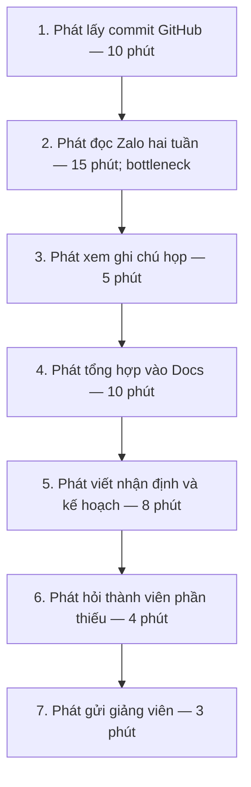
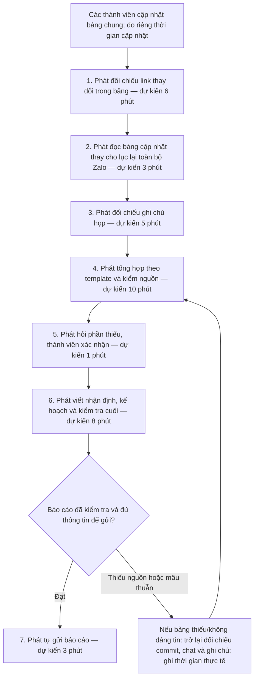

# CP5 — Thiết kế quy trình cho Card #1 của Phát

- Phần việc của Lê Sông Thao theo TEAM.md: chủ trì quy trình trước/sau, before/after và assets; Phát hỗ trợ.
- Được Codex hỗ trợ tổng hợp, chuyển sang Mermaid và rà soát ngày 09/11/2026. Nội dung quy trình đã được tích hợp vào mục 4 của báo cáo nhóm.
- Phạm vi: tổng hợp một báo cáo tiến độ hai tuần của nhóm bốn người cho giảng viên. Đây là thiết kế quy trình, chưa phải kết quả pilot hay quyết định CP6 của nhóm.

## 1. Nguồn và mức chắc chắn

| Nội dung | Nguồn / trạng thái |
|---|---|
| Phát tự bấm giờ 3 báo cáo: 38, 71, 55 phút | [Card #1 của Phát](https://github.com/Ntd1411/K5-L3A-DAY02-Nhom4AE-DiscoveryProblemFraming/blob/627065150a8fb412411752b9f4530cc04e861232/report/individual/2A202603536_TranHoangPhat.md). Trung bình 54,67 phút, làm tròn khoảng 55. Chưa kèm ngày hoặc log gốc của từng lần. |
| Thời gian từng bước hiện tại 10/15/5/10/8/4/3 phút | Sơ đồ hiện tại trong card Phát; tổng 55 phút. Không tự coi đây là bảy thời gian đã được đo riêng ở cả ba kỳ. |
| No AI giảm khoảng 19 phút | Giả thuyết trong card: lấy commit giảm 4 phút; đọc Zalo giảm 12 phút; hỏi phần thiếu giảm 3 phút. Tổng tương lai 36 phút là tính toán từ giả thuyết, chưa đo. |
| Vai trò Thao/Phát | [TEAM.md trên main](https://github.com/Ntd1411/K5-L3A-DAY02-Nhom4AE-DiscoveryProblemFraming/blob/627065150a8fb412411752b9f4530cc04e861232/TEAM.md). |

## 2. Quy trình hiện tại — khoảng 55 phút

| Bước | Actor | Input | Output | Thời gian hiện tại theo card |
|---:|---|---|---|---:|
| 1 | Phát | Commit trong kỳ, danh sách thành viên | Danh sách thay đổi và đường dẫn | 10 phút |
| 2 | Phát | Tin nhắn Zalo trong hai tuần | Ghi chú ai làm gì, việc thiếu/blocker | 15 phút |
| 3 | Phát | Ghi chú họp | Quyết định và kế hoạch đã thống nhất | 5 phút |
| 4 | Phát | Thông tin bước 1–3 | Bản tổng hợp trong Docs | 10 phút |
| 5 | Phát | Bản tổng hợp, kết quả và blocker | Nhận định, kế hoạch kỳ tới | 8 phút |
| 6 | Phát và thành viên liên quan | Nội dung thiếu hoặc chưa rõ | Thông tin được bổ sung/xác nhận | 4 phút |
| 7 | Phát | Bản báo cáo hoàn thiện | Báo cáo được gửi giảng viên | 3 phút |

**Bottleneck:** bước 2, phải tìm công việc trong tin nhắn lẫn nhiều nội dung khác. Commit là nguồn chứng cứ thay đổi mã, không tự xác nhận công việc đã hoàn thành hoặc bao phủ phần việc ngoài code.

## 3. Quy trình tương lai A — bảng chung, No AI

Điều kiện đầu vào: mỗi thành viên cập nhật bảng chung khi có tiến triển. Trường tối thiểu đề xuất: kỳ báo cáo, mã/tên việc, người phụ trách, trạng thái được người đó xác nhận, nguồn chứng cứ, blocker và bước tiếp theo. Chi phí cập nhật của từng người chưa được đo và phải được ghi riêng.

| Bước | Actor / mức xử lý | Input → output | Thời gian dự kiến | Kiểm tra / giới hạn |
|---:|---|---|---:|---|
| 1 | Phát, con người | Bảng và link commit → thay đổi trong kỳ | 6 phút | Chọn đúng kỳ; không suy trạng thái Done từ số commit. |
| 2 | Phát, con người | Bảng cập nhật → danh sách việc và blocker | 3 phút | Giữ việc ngoài code; không bỏ qua thông tin còn thiếu. |
| 3 | Phát, con người | Ghi chú họp → quyết định/kế hoạch | 5 phút | Đối chiếu bản đã thống nhất, chưa biến đề xuất thành cam kết. |
| 4 | Phát, con người | Nguồn đã gom → bản tổng hợp theo template | 10 phút | Kiểm nguồn trong lúc tổng hợp; mọi thời gian sửa đều phải được tính. |
| 5 | Phát và thành viên liên quan, con người | Điểm thiếu → thông tin được bổ sung hoặc ghi rõ chưa xác nhận | 1 phút | Đưa hỏi/xác nhận lên trước kiểm tra cuối; mốc 1 phút là giả thuyết cho kỳ ít thiếu dữ liệu. |
| 6 | Phát, con người | Bản tổng hợp đã bổ sung → nhận định/kế hoạch và bản đã kiểm tra | 8 phút | Kiểm tra lại sau mọi thông tin mới. Nếu không đủ thời gian hoặc cần sửa, ghi tăng thực tế. |
| 7 | Phát, con người | Bản đã kiểm → báo cáo gửi giảng viên | 3 phút | Phát chịu trách nhiệm gửi; không tự động gửi bản chưa kiểm tra. |

**Tổng dự kiến khi có hỏi bổ sung ở bước 5 và không quay về:** `6 + 3 + 5 + 10 + 1 + 8 + 3 = 36 phút`. Đây là ước tính cho thời gian của người tổng hợp. Bước hỏi thiếu đã được đưa lên trước viết/kiểm tra cuối; cập nhật từ thành viên không được đi thẳng tới bước gửi khi chưa kiểm tra lại. Nếu không cần hỏi thì ghi 0 phút cho bước 5; nếu chờ lâu, sửa hoặc quay về, ghi đúng phần phát sinh.

**Boundary:** không tự gán Done, đổi người phụ trách/deadline hoặc tạo cam kết chưa được nhóm xác nhận; không sao chép thông tin riêng tư lên repo công khai. Phát kiểm nguồn, nhận định và người nhận trước khi gửi. Phương án A không có bước AI.

**Phương án quay về:** nếu bảng không được cập nhật, dữ liệu mâu thuẫn hoặc không truy được nguồn, Phát đối chiếu lại commit/chat/ghi chú, hỏi thành viên và viết theo template thủ công. Ghi phần chưa xác nhận thay vì tự điền cho đủ; thời gian phát sinh vẫn nằm trong kết quả đo.

## 4. Before / after và cách đo

| Chỉ số | Hiện tại | Phương án A, kỳ vọng | Giới hạn cần theo dõi |
|---|---|---|---|
| Bước của người tổng hợp | 7 | 7, có nhánh kiểm tra/quay về | Ngoài ra có cập nhật bảng của từng thành viên; chưa đếm vào 7 bước. |
| Thời gian người tổng hợp | Khoảng 55 phút, 3 kỳ tự báo cáo 38/71/55 | Khoảng 36 phút; target dưới 40 | Chưa có pilot. Không loại thời gian sửa/kiểm tra để đạt target. |
| Bước chính do con người làm | 7 | 7 | Lợi ích đến từ cấu trúc thông tin, chưa phải tự động hóa. |
| Đọc/tìm thông tin chat | Khoảng 15 phút | Khoảng 3 phút đọc bảng | Nếu vẫn phải lục Zalo, ghi đúng thời gian thay vì giữ 3 phút. |
| Tổng công sức cả nhóm | Chưa có baseline | Chưa xác định | Đo cập nhật bảng của cả 4 người, gồm Phát, và thời gian trả lời bổ sung của các thành viên khác; không đếm trùng thời gian Phát đã tính trong tổng hợp. |
| Chất lượng báo cáo | Số câu giảng viên hỏi lại trong 3 kỳ trước còn thiếu | Số câu hỏi lại do thiếu/sai thông tin không tăng | Cần phân biệt hỏi làm rõ lỗi báo cáo với câu hỏi chuyên môn mới. |
| Rủi ro mới | Nguồn phân tán, dễ bỏ sót | Bảng chậm cập nhật hoặc trạng thái sai | Thành viên xác nhận trạng thái, Phát kiểm nguồn, có cách quay về. |

Đề xuất ghi log mỗi kỳ: thời điểm bắt đầu/kết thúc từng bước; thời gian kiểm tra/sửa; có quay về không; tổng phút của Phát; tổng phút cập nhật bảng của cả 4 người và trả lời bổ sung của các thành viên khác; thông tin bị thiếu/sai; câu giảng viên hỏi lại và nguyên nhân. Dùng cùng quy ước tính thời gian với baseline; ghi riêng thời gian chờ bị gián đoạn nếu có. Thu thập số câu hỏi lại của 3 kỳ cũ trước khi so chất lượng; giá trị còn thiếu ghi “chưa có dữ liệu”, không thay bằng 0.

Card Phát đề xuất thử bảng chung 2 kỳ trước khi cân nhắc AI, và theo dõi 4 kỳ báo cáo. Với chu kỳ hai tuần, đây là kế hoạch dài khoảng 4 và 8 tuần, không phải việc đã chạy xong trong lab. Ngưỡng dừng và quyết định pilot cần Phát cùng nhóm tự chốt ở CP6.

## 5. Điều kiện cân nhắc phương án B — Workflow có AI

Chỉ phân tích tiếp nếu dữ liệu pilot cho thấy bảng chung chưa đủ và xác định được phần nghẽn còn lại. Nếu tổng vẫn trên 40 phút nhưng chủ yếu do thành viên không cập nhật, AI soạn nháp không giải được nguyên nhân đó.

Nếu chọn thử Workflow sau kiểm chứng, phạm vi đề xuất là input đã gom và được phép dùng → AI soạn nháp nội dung tổng hợp/nhận định → Phát hỏi xác nhận phần thiếu → Phát đối chiếu/sửa và kiểm tra cuối → Phát gửi. Đó là phần việc tương ứng bước 4–5 của quy trình hiện tại; không nhầm với số thứ tự của quy trình tương lai đã đổi thứ tự hỏi/kiểm tra. Mục tiêu dưới 25 phút trong card là giả thuyết; cần tính cả chuẩn bị input, chạy AI, kiểm tra và sửa. Chưa có số phút tương lai để điền như kết quả đo.

Boundary cần giữ: AI không tự xác nhận hoàn thành, đổi owner/deadline, tạo cam kết, suy nhận định thiếu nguồn hoặc tự gửi báo cáo. Khi đầu ra thiếu nguồn/sai trạng thái, bỏ bản nháp AI và quay về template cùng dữ liệu đã xác nhận. Giang chủ trì đánh giá mức can thiệp, tiêu chí đầu ra và PS v1; Phát chủ trì rủi ro và quyết định.

## 6. Các điểm cần tiếp tục kiểm chứng

- [ ] Thời gian từng bước hiện tại là đo riêng hay ước lượng phân bổ; bổ sung log nếu có.
- [ ] Bảng chung thực sự có các trường nhóm dùng và không phát sinh nhập lại không cần thiết.
- [x] Trong thiết kế, kiểm tra/sửa nằm trong tổng; dữ liệu thiếu có nhánh quay về; kiểm tra cuối đặt sau bước hỏi bổ sung.
- [ ] Đo cả công sức cập nhật của thành viên để tránh chuyển gánh nặng.
- [ ] Bổ sung baseline chất lượng; thống nhất với Giang/Dũng về metric và boundary.
- [x] Đã tích hợp thiết kế CP5 vào mục 4 của group_report.md; thời gian tương lai vẫn ghi là ước tính, chưa phải kết quả pilot hoặc PS đã chốt.
