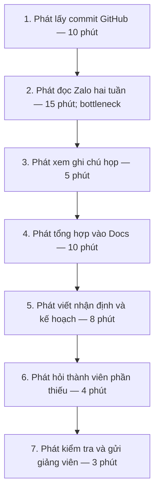
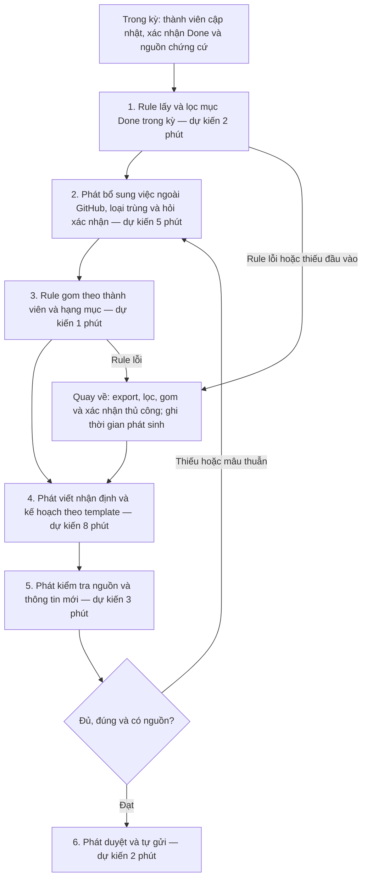

# CP5 — Quy trình theo quyết định Rule của nhóm

- Phụ trách: Lê Sông Thao; Trần Hoàng Phát hỗ trợ theo TEAM.md. Codex hỗ trợ Mermaid, tính toán và rà soát tài liệu.
- Đồng bộ ngày 09/11/2026 với [bản nhóm CP5–CP6, commit 53f9eb6](https://github.com/Ntd1411/K5-L3A-DAY02-Nhom4AE-DiscoveryProblemFraming/blob/53f9eb6/report/team/group_report.md): **Go — pilot nhỏ với Rule**. Nội dung đã tích hợp vào mục 4 báo cáo nhóm.
- Phạm vi: một báo cáo tiến độ hai tuần của nhóm bốn người; thời gian tương lai là ước tính thiết kế, không phải kết quả thử nghiệm.

## 1. Nguồn và các phương án

| Nội dung | Căn cứ / trạng thái |
|---|---|
| Baseline 38, 71, 55 phút | [Card Phát tại mốc main](https://github.com/Ntd1411/K5-L3A-DAY02-Nhom4AE-DiscoveryProblemFraming/blob/627065150a8fb412411752b9f4530cc04e861232/report/individual/2A202603536_TranHoangPhat.md): tự báo cáo 3 lần bấm giờ, trung bình 54,67 phút, làm tròn khoảng 55. Chưa có log gốc từng kỳ. |
| Thời gian hiện tại từng bước 10/15/5/10/8/4/3 | Sơ đồ trong card Phát và bản nhóm. Chưa chứng minh các bước đã được bấm giờ riêng ở cả 3 kỳ. |
| No AI khoảng 36 phút, mục tiêu dưới 40 | Phương án tham chiếu từ card gốc: giảm bước lấy commit 4 phút, đọc lại thông tin 12 phút, hỏi thiếu 3 phút; `55 - 19 = 36`. Là ước tính, dùng đối chiếu và quay về thủ công; không phải phương án cuối ở CP6. |
| Rule khoảng 21 phút, target dưới 25 | Quyết định trong bản nhóm tại 53f9eb6: lọc/gom theo quy tắc; con người bổ sung, viết, kiểm tra và gửi. Chưa có kết quả pilot. |
| Workflow/Agent | Chưa chọn. Chỉ xem xét AI sau khi pilot chứng minh Rule không đủ và xác định phần nghẽn còn lại. |

## 2. Quy trình hiện tại — khoảng 55 phút

| Bước | Actor | Input | Output | Thời gian hiện tại theo card |
|---:|---|---|---|---:|
| 1 | Phát | Commit trong kỳ, danh sách thành viên | Danh sách thay đổi và đường dẫn | 10 phút |
| 2 | Phát | Tin nhắn Zalo trong hai tuần | Ghi chú ai làm gì, việc thiếu/blocker | 15 phút |
| 3 | Phát | Ghi chú họp | Quyết định và kế hoạch đã thống nhất | 5 phút |
| 4 | Phát | Thông tin bước 1–3 | Bản tổng hợp trong Docs | 10 phút |
| 5 | Phát | Bản tổng hợp, kết quả và blocker | Nhận định, kế hoạch kỳ tới | 8 phút |
| 6 | Phát và thành viên liên quan | Nội dung thiếu hoặc chưa rõ | Thông tin được bổ sung/xác nhận | 4 phút |
| 7 | Phát | Bản báo cáo hoàn thiện | Báo cáo được kiểm tra và gửi giảng viên | 3 phút |

**Bottleneck:** bước 2, phải tìm công việc trong tin nhắn lẫn nhiều nội dung khác. Commit là nguồn chứng cứ thay đổi mã, không tự xác nhận công việc đã hoàn thành hoặc bao phủ phần việc ngoài code.

## 3. Quy trình tương lai được chọn — Rule, khoảng 21 phút

**Đầu vào trong kỳ:** bốn thành viên cập nhật task có người phụ trách, hạng mục, kết quả, trạng thái được xác nhận, ngày hoàn thành và liên kết bằng chứng. Nhóm trưởng đề xuất khoảng 1–2 phút/task và giới hạn 10 phút/người/kỳ; đây là giả thuyết cần đo. Thời gian cập nhật này nằm ngoài 21 phút lập báo cáo và vẫn phải tính vào công sức cả nhóm.

| Bước khi lập báo cáo | Loại | Actor | Input → output | Thời gian kỳ vọng | Kiểm tra / boundary |
|---:|---|---|---|---:|---|
| 1 | Rule | Bộ lọc theo quy tắc | Task board, issue/PR và kỳ báo cáo → danh sách mục hợp lệ | 2 phút | Chỉ đọc nguồn được phép; lấy theo ngày hoàn thành trong kỳ; không suy Done từ commit hoặc việc PR đã merge. |
| 2 | Con người | Phát và thành viên liên quan | Danh sách, ghi chú họp và xác nhận → việc ngoài GitHub, mục đã loại trùng và thông tin còn thiếu | 5 phút | Dùng mã task để tránh một việc bị đếm nhiều lần theo các PR; thiếu hoặc mâu thuẫn thì hỏi người phụ trách. |
| 3 | Rule | Bộ gom dữ liệu | Danh sách đã đối chiếu → bảng theo owner/hạng mục | 1 phút | Chỉ sắp xếp/định dạng, không tự thay đổi trạng thái, deadline hoặc mức ưu tiên. |
| 4 | Con người | Phát | Bảng và nguồn → nhận định/kế hoạch theo template | 8 phút | Giữ quyền diễn giải ở con người; không tạo cam kết chưa xác nhận. |
| 5 | Con người | Phát | Bản báo cáo và nguồn → bản đã kiểm tra | 3 phút | Kiểm tra đủ thành viên, đúng kỳ, trạng thái, nguồn và blocker; mọi bổ sung mới phải qua bước này trước khi gửi. |
| 6 | Con người | Phát | Bản đạt kiểm tra → báo cáo được gửi giảng viên | 2 phút | Chỉ Phát duyệt và gửi; Rule không có quyền gửi. |

**Tổng:** `2 + 5 + 1 + 8 + 3 + 2 = 21 phút`, gồm **6 bước ở thời điểm lập báo cáo: 2 Rule + 4 con người**. Cộng thêm hoạt động cập nhật task trong kỳ thành 7 hoạt động của thiết kế mới. Tất cả số phút tương lai là ước tính; thời gian hỏi, sửa, chờ hoặc quay về phát sinh phải ghi đủ, không giữ cứng 21 phút.

**Phương án quay về:** Rule lỗi, thiếu trường hoặc không lấy được dữ liệu thì người phụ trách export task board, lọc/gom thủ công, bổ sung việc ngoài GitHub và đối chiếu nguồn. Sau đó vẫn tự viết nhận định, kiểm tra và gửi; không bỏ qua kiểm tra để giữ target. Bản gốc chỉ được đọc, không bị sửa/xóa.

**Boundary chung:** không đọc lịch sử chat riêng tư; không suy hoàn thành từ số commit, Closed hay Merged; không tự đổi owner/deadline, bịa task hoặc gửi báo cáo. Trạng thái và ngày hoàn thành phải do người phụ trách việc xác nhận. Dữ liệu chưa xác nhận được ghi rõ và được xử lý trước khi gửi.

## 4. Before / after và kế hoạch đo

| Chỉ số | Hiện tại | Rule, kỳ vọng | Phạm vi / giới hạn |
|---|---|---|---|
| Bước tại thời điểm lập báo cáo | 7 | 6 | Có thêm hoạt động cập nhật task trong kỳ; không tính nó thành thao tác lập báo cáo. |
| Thao tác thủ công tại thời điểm lập báo cáo | 7 | 4 | Hai bước còn lại là lọc và gom bằng Rule. |
| Thời gian người tổng hợp | Khoảng 55 phút; mẫu 38/71/55 | Khoảng 21 phút; target dưới 25 phút/kỳ | Chưa có pilot; tính cả kiểm tra, sửa và quay về. |
| Tổng thời gian Rule | Không có | Khoảng 3 phút: lọc 2 + gom 1 | Tiêu chí CP6 cần nhất quán với cả hai bước, không nhầm tổng Rule thành dưới 2 phút. |
| Bottleneck | Đọc Zalo khoảng 15 phút | Viết nhận định khoảng 8 phút | Judgment do Phát giữ. |
| Cập nhật của mỗi thành viên trong kỳ | Chưa có baseline | Mục tiêu không quá 10 phút/người/kỳ | Ghi cho cả 4 người, gồm Phát; không đếm trùng phần tổng hợp. |
| Chất lượng | Baseline câu giảng viên hỏi lại còn thiếu | Không bỏ sót mục hợp lệ, đúng owner/kỳ và 100% có nguồn | Báo số mục thiếu/sai, không chỉ đếm câu hỏi của giảng viên. |
| Rủi ro mới | Thông tin phân tán | Task thiếu trường, sai trạng thái hoặc Rule lọc sai | Bắt buộc xác nhận, đối chiếu, và có export/template thủ công. |

Đo từng bước mỗi kỳ; ghi thời gian sửa/quay về, thời gian cập nhật task của cả 4 người, mục bị bỏ sót/sai và nguồn đối chiếu. Dùng cùng quy ước tính thời gian với baseline; ghi riêng thời gian chờ nếu có. Dữ liệu chất lượng chưa có ghi “chưa có dữ liệu”, không thay bằng 0.

Quy ước bổ sung tại [báo cáo nhóm mục 4.4](../team/group_report.md#44-quy-ước-kiểm-tra-và-ghi-nhận): tính cả thời gian chờ cần thiết trong target dưới 25 phút, tách công sức thao tác; baseline chưa rõ cách tính chờ nên chưa công bố tỷ lệ tiết kiệm. Tập task hợp lệ phải được con người đối chiếu độc lập trước khi xem đầu ra Rule. Sau hỏi/bổ sung, kiểm lại kỳ, trạng thái và nguồn trước khi gom; mục còn thiếu được giữ riêng. [Kế hoạch đo](cp6-pilot-measurement-plan.md) và hai mẫu CSV quy định chi tiết cách thực hiện.

Pilot theo quyết định nhóm: thử 2 kỳ, nếu đạt tiếp tục tới đủ 4 kỳ liên tiếp. Với chu kỳ hai tuần, tương ứng khoảng 4 và 8 tuần; đây là kế hoạch, chưa chạy xong trong lab. Ngưỡng dừng và tiêu chí chính thức xem mục 7–8 báo cáo nhóm.

## 5. Các điểm đã rà soát và còn cần dữ liệu

- [x] Phương án chính là Rule theo CP6; No AI 36 phút được tách thành đối chiếu.
- [x] Tổng tương lai 21 phút gồm 2 bước Rule và 4 bước con người; cập nhật trong kỳ được đo riêng.
- [x] Mọi nội dung bổ sung đều đi qua kiểm tra cuối; có nhánh quay về.
- [x] Mốc dưới 25 phút là target; tổng Rule dự kiến 3 phút được phân biệt với thời gian lọc 2 phút.
- [x] Có tập đối chiếu độc lập, cách ghi thời gian chờ/công sức và biểu mẫu để thực hiện pilot.
- [ ] Bổ sung log baseline gốc, thời gian chờ và baseline chất lượng nếu có.
- [ ] Thu log pilot và chi phí cập nhật thực tế trước khi kết luận đạt.
