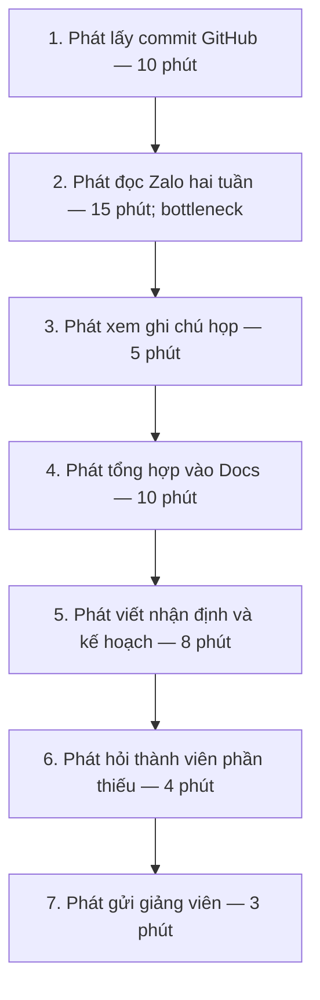
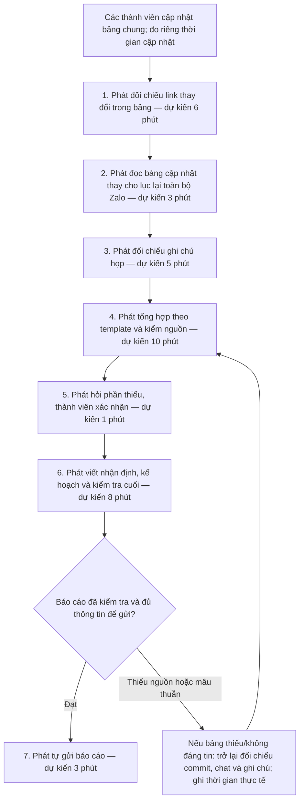

# Báo cáo nhóm — Day 02 Discovery & Problem Framing

> Bản chung của nhóm, viết trên repo do nhóm trưởng fork. Không copy file này sang repo cá nhân.
> Template chi tiết và prompt mẫu: [docs/01-worksheet.md](../../docs/01-worksheet.md). Bài mẫu: [docs/02-deliverable-example.md](../../docs/02-deliverable-example.md).

## 1. Thông tin nhóm

- Tên nhóm:
- Thành viên: xem `TEAM.md`
- Candidate problem được chọn (1 câu):
- Quyết định cuối: Go / Not Yet / No-Go

---

## 2. Hội tụ nhóm (CP3)

### 2.1. Pitch

| # | Người đưa ra | Candidate (Job Story ngắn) | Actor | Bottleneck | Câu hỏi phản biện nhận được (ai hỏi) |
|---:|---|---|---|---|---|
| 1 | | | | | |
| 2 | | | | | |
| 3 | | | | | |
| 4 | | | | | |
| 5 | | | | | |
| 6 | | | | | |
| 7 | | | | | |
| 8 | | | | | |
| 9 | | | | | |
| 10 | | | | | |
| 11 | | | | | |
| 12 | | | | | |

### 2.2. Cluster

| Cluster | Các candidate | Pattern chung |
|---|---|---|
| A | | |
| B | | |
| C | | |

### 2.3. Opportunity Solution Tree rút gọn

Gốc là **1 outcome**. Nhánh là **opportunity** (nhu cầu, pain), không phải tính năng hay công cụ.

```text
OUTCOME: 
├── Opportunity A: 
├── Opportunity B: 
└── Opportunity C: 
```

Những ý đã gạch bỏ vì là solution đội lốt opportunity:

-

### 2.4. Chấm điểm shortlist (1–5)

| Candidate | Actor rõ | Quy trình rõ | Pain có bằng chứng | Impact đo được | Vừa sức lab | So sánh được No AI/Rule/Workflow/Agent | Nhóm hiểu domain | Tổng |
|---|---:|---:|---:|---:|---:|---:|---:|---:|
| | | | | | | | | |
| | | | | | | | | |
| | | | | | | | | |

**Candidate được chọn:**

**Vì sao chọn:**

**Vì sao loại các candidate còn lại:**

**Xử lý bất đồng (nếu có):**

---

## 3. Kiểm chứng + research giải pháp đã có (CP4)

### 3.1. Assumption Map

| # | Giả định | Loại (Value / Usability / Feasibility / Viability) | Quan trọng (1–5) | Đã có bằng chứng (1–5) | Kiểm chứng trước? |
|---:|---|---|---:|---:|---|
| 1 | | | | | |
| 2 | | | | | |
| 3 | | | | | |
| 4 | | | | | |
| 5 | | | | | |
| 6 | | | | | |

*Điền 4–6 giả định; xóa dòng thừa.*

Giả định nhóm kiểm chứng trong buổi này:

### 3.2. Kiểm chứng

Cách đã dùng: Phỏng vấn / Survey / Log, ticket, review

Interview snapshot (mỗi buổi phỏng vấn một bảng, hoặc đặt file trong `report/assets/cp4-interview-snapshot-N.md`):

| Trường | Nội dung |
|---|---|
| Người được hỏi (vai trò, không ghi tên thật) | |
| Câu nói đáng nhớ nhất (nguyên văn) | |
| Lần gần nhất gặp vấn đề này: chuyện gì đã xảy ra? | |
| Hiện đang xử lý bằng cách nào (workaround)? | |
| Mất bao lâu, bao lần? | |
| Insight / opportunity rút ra | |

Tổng hợp:

| Nguồn | Số người / số mẫu | Tín hiệu xác nhận | Tín hiệu phản bác |
|---|---:|---|---|
| | | | |

**Nhóm đã sửa problem thế nào sau kiểm chứng:**

### 3.3. Research giải pháp đã có

| Công cụ / case / pattern | Link | Giải bước nào trong quy trình? | Điểm mạnh | Khoảng trống / rủi ro | Bài học cho nhóm |
|---|---|---|---|---|---|
| | | | | | |
| | | | | | |
| | | | | | |

---

## 4. Quy trình trước/sau (CP5)

**Phụ trách:** Lê Sông Thao; Trần Hoàng Phát hỗ trợ theo [TEAM.md](../../TEAM.md). Có dùng Codex hỗ trợ vẽ Mermaid và rà soát tính nhất quán.

**Nguồn đầu vào:** [Card #1 của Phát trên main tại mốc đối chiếu](https://github.com/Ntd1411/K5-L3A-DAY02-Nhom4AE-DiscoveryProblemFraming/blob/627065150a8fb412411752b9f4530cc04e861232/report/individual/2A202603536_TranHoangPhat.md). Phát tự báo cáo 3 lần bấm giờ 38, 71, 55 phút; trung bình 54,67 phút, làm tròn khoảng 55 phút/kỳ. Thời gian từng bước lấy từ sơ đồ trong card; chưa có log gốc chứng minh từng bước đã được đo riêng ở cả 3 kỳ. [Tài liệu CP5 và nguồn tại mốc main được đọc](../assets/cp5-lesongthao-workflow-draft.md).

**Phạm vi thiết kế:** phương án bảng chung No AI là phương án thử trước theo card; thời gian tương lai là ước tính. Mức chọn cuối, Problem Statement và quyết định thuộc CP6; các kết quả kiểm chứng chưa có cần được bổ sung ở CP4.

### 4.1. Quy trình hiện tại — khoảng 55 phút



| Bước | Actor | Input | Output | Thời gian hiện tại theo card |
|---:|---|---|---|---:|
| 1 | Phát | Commit trong kỳ, danh sách thành viên | Danh sách thay đổi và đường dẫn | 10 phút |
| 2 | Phát | Tin nhắn Zalo trong hai tuần | Ghi chú ai làm gì, việc thiếu/blocker | 15 phút |
| 3 | Phát | Ghi chú họp | Quyết định và kế hoạch đã thống nhất | 5 phút |
| 4 | Phát | Thông tin bước 1–3 | Bản tổng hợp trong Docs | 10 phút |
| 5 | Phát | Bản tổng hợp, kết quả và blocker | Nhận định, kế hoạch kỳ tới | 8 phút |
| 6 | Phát và thành viên liên quan | Nội dung thiếu hoặc chưa rõ | Thông tin được bổ sung/xác nhận | 4 phút |
| 7 | Phát | Bản báo cáo hoàn thiện | Báo cáo được gửi giảng viên | 3 phút |

**Bottleneck:** bước 2, phải tìm công việc trong tin nhắn lẫn nhiều nội dung khác. Commit là nguồn chứng cứ thay đổi mã, không tự xác nhận công việc đã hoàn thành hoặc bao phủ phần việc ngoài code.

### 4.2. Quy trình tương lai — bảng chung, No AI

Điều kiện đầu vào: mỗi thành viên cập nhật bảng chung khi có tiến triển. Trường tối thiểu đề xuất: kỳ báo cáo, mã/tên việc, người phụ trách, trạng thái được người đó xác nhận, nguồn chứng cứ, blocker và bước tiếp theo. Chi phí cập nhật của từng người chưa được đo và phải được ghi riêng.



| Bước | Actor / mức xử lý | Input → output | Thời gian dự kiến | Kiểm tra / giới hạn |
|---:|---|---|---:|---|
| 1 | Phát, con người | Bảng và link commit → thay đổi trong kỳ | 6 phút | Chọn đúng kỳ; không suy trạng thái Done từ số commit. |
| 2 | Phát, con người | Bảng cập nhật → danh sách việc và blocker | 3 phút | Giữ việc ngoài code; không bỏ qua thông tin còn thiếu. |
| 3 | Phát, con người | Ghi chú họp → quyết định/kế hoạch | 5 phút | Đối chiếu bản đã thống nhất, chưa biến đề xuất thành cam kết. |
| 4 | Phát, con người | Nguồn đã gom → bản tổng hợp theo template | 10 phút | Kiểm nguồn trong lúc tổng hợp; mọi thời gian sửa đều phải được tính. |
| 5 | Phát và thành viên liên quan, con người | Điểm thiếu → thông tin được bổ sung hoặc ghi rõ chưa xác nhận | 1 phút | Đưa hỏi/xác nhận lên trước kiểm tra cuối; mốc 1 phút là giả thuyết cho kỳ ít thiếu dữ liệu. |
| 6 | Phát, con người | Bản tổng hợp đã bổ sung → nhận định/kế hoạch và bản đã kiểm tra | 8 phút | Kiểm tra lại sau mọi thông tin mới. Nếu không đủ thời gian hoặc cần sửa, ghi tăng thực tế. |
| 7 | Phát, con người | Bản đã kiểm → báo cáo gửi giảng viên | 3 phút | Phát chịu trách nhiệm gửi; không tự động gửi bản chưa kiểm tra. |

**Tổng dự kiến khi có hỏi bổ sung ở bước 5 và không quay về:** `6 + 3 + 5 + 10 + 1 + 8 + 3 = 36 phút`. Đây là ước tính cho thời gian của người tổng hợp. Bước hỏi thiếu đã được đưa lên trước viết/kiểm tra cuối; cập nhật từ thành viên không được đi thẳng tới bước gửi khi chưa kiểm tra lại. Nếu không cần hỏi thì ghi 0 phút cho bước 5; nếu chờ lâu, sửa hoặc quay về, ghi đúng phần phát sinh.

**Boundary:** không tự gán Done, đổi người phụ trách/deadline hoặc tạo cam kết chưa được nhóm xác nhận; không sao chép thông tin riêng tư lên repo công khai. Phát kiểm nguồn, nhận định và người nhận trước khi gửi. Phương án A không có bước AI.

**Phương án quay về:** nếu bảng không được cập nhật, dữ liệu mâu thuẫn hoặc không truy được nguồn, Phát đối chiếu lại commit/chat/ghi chú, hỏi thành viên và viết theo template thủ công. Ghi phần chưa xác nhận thay vì tự điền cho đủ; thời gian phát sinh vẫn nằm trong kết quả đo.

### 4.3. Before / after và cách đo

| Chỉ số | Hiện tại | Phương án A, kỳ vọng | Giới hạn cần theo dõi |
|---|---|---|---|
| Bước của người tổng hợp | 7 | 7, có nhánh kiểm tra/quay về | Ngoài ra có cập nhật bảng của từng thành viên; chưa đếm vào 7 bước. |
| Thời gian người tổng hợp | Khoảng 55 phút, 3 kỳ tự báo cáo 38/71/55 | Khoảng 36 phút; target dưới 40 | Chưa có pilot. Không loại thời gian sửa/kiểm tra để đạt target. |
| Bước chính do con người làm | 7 | 7 | Lợi ích đến từ cấu trúc thông tin, chưa phải tự động hóa. |
| Đọc/tìm thông tin chat | Khoảng 15 phút | Khoảng 3 phút đọc bảng | Nếu vẫn phải lục Zalo, ghi đúng thời gian thay vì giữ 3 phút. |
| Tổng công sức cả nhóm | Chưa có baseline | Chưa xác định | Đo cập nhật bảng của cả 4 người, gồm Phát, và thời gian trả lời bổ sung của các thành viên khác; không đếm trùng thời gian Phát đã tính trong tổng hợp. |
| Chất lượng báo cáo | Số câu giảng viên hỏi lại trong 3 kỳ trước còn thiếu | Số câu hỏi lại do thiếu/sai thông tin không tăng | Cần phân biệt hỏi làm rõ lỗi báo cáo với câu hỏi chuyên môn mới. |
| Rủi ro mới | Nguồn phân tán, dễ bỏ sót | Bảng chậm cập nhật hoặc trạng thái sai | Thành viên xác nhận trạng thái, Phát kiểm nguồn, có cách quay về. |

Đề xuất ghi log mỗi kỳ: thời điểm bắt đầu/kết thúc từng bước; thời gian kiểm tra/sửa; có quay về không; tổng phút của Phát; tổng phút cập nhật bảng của cả 4 người và trả lời bổ sung của các thành viên khác; thông tin bị thiếu/sai; câu giảng viên hỏi lại và nguyên nhân. Dùng cùng quy ước tính thời gian với baseline; ghi riêng thời gian chờ bị gián đoạn nếu có. Thu thập số câu hỏi lại của 3 kỳ cũ trước khi so chất lượng; giá trị còn thiếu ghi “chưa có dữ liệu”, không thay bằng 0.

Card Phát đề xuất thử bảng chung 2 kỳ trước khi cân nhắc AI, và theo dõi 4 kỳ báo cáo. Với chu kỳ hai tuần, đây là kế hoạch dài khoảng 4 và 8 tuần, không phải việc đã chạy xong trong lab. Ngưỡng dừng và quyết định pilot cần Phát cùng nhóm tự chốt ở CP6.

**Nhánh Workflow có điều kiện:** nếu kiểm chứng cho thấy bảng chung chưa đủ và phần tổng hợp/nhận định vẫn là điểm nghẽn, Giang phân tích thêm AI soạn nháp từ dữ liệu đã gom. Mục tiêu dưới 25 phút là mục tiêu thử nghiệm riêng, không gộp với target No AI dưới 40 phút. Phát vẫn hỏi xác nhận phần thiếu, đối chiếu/sửa và kiểm tra cuối trước khi gửi; khi đầu ra thiếu nguồn hoặc sai trạng thái, quay về template và dữ liệu đã xác nhận.

---

## 5. Problem Statement v0 (CP5)

| Trường | Nội dung |
|---|---|
| **Actor** | |
| **Quy trình** | |
| **Bottleneck** | |
| **Impact** | |
| **Success Metric** (baseline → target, cách đo) | |
| **Boundary** (AI không được làm gì; khi nào cần con người kiểm tra — HITL) | |

Phản biện nhận được (từ AI hoặc nhóm khác) và nhóm có đồng ý không:

-

---

## 6. Mức can thiệp AI (CP6)

### 6.1. Ma trận độ mơ hồ × độ phức tạp

Bài của nhóm nằm ở ô:

Vì sao:

### 6.2. So sánh 4 mức

| Mức | Phương án cho bài của nhóm | Đủ khi nào | Rủi ro | Chọn? |
|---|---|---|---|---|
| **No AI** (sửa quy trình) | | | | |
| **Rule** | | | | |
| **Workflow** | | | | |
| **Agent** | | | | |

**Mức chọn:**

**Vì sao không chọn mức đơn giản hơn:**

### 6.3. AI Canvas rút gọn

| Thành phần | Nội dung |
|---|---|
| **Prediction** — AI dự đoán / tạo ra gì? | |
| **Judgment** — con người cân nhắc, quyết định gì? | |
| **Action** — hành động cuối cùng là gì, ai làm? | |
| **Outcome** — đo kết quả bằng gì? | |
| **Input** — AI cần dữ liệu đầu vào gì mỗi lần chạy? Có sẵn không? | |
| **Feedback** — lấy phản hồi ở đâu để cải thiện? | |

### 6.4. Hai câu hỏi của Google PAIR

- Người dùng muốn **được hỗ trợ (augment)** hay **giao hẳn việc (automate)**? Bằng chứng:
- AI sai kiểu nào tệ hơn, **báo nhầm** hay **bỏ sót**? Vì sao, và thiết kế đã xử lý thế nào:

---

## 7. Problem Statement v1 + tiêu chí đánh giá (CP6)

| Trường | Nội dung |
|---|---|
| **Actor** | |
| **Quy trình** | |
| **Bottleneck** | |
| **Impact** | |
| **Success Metric** (baseline → target, cách đo) | |
| **Boundary** | |
| **AI intervention point** | |
| **Mức chọn** | No AI / Rule / Workflow / Agent |
| **Rủi ro & người kiểm tra** | |

**Thay đổi so với v0 và lý do:**

| Trường | v0 | v1 | Vì sao đổi |
|---|---|---|---|
| | | | |

**Tiêu chí đánh giá đầu ra của AI (3–5 tiêu chí):**

| # | Tiêu chí | Đạt khi | Không đạt khi |
|---:|---|---|---|
| 1 | | | |
| 2 | | | |
| 3 | | | |

---

## 8. Quyết định (CP6)

### 8.1. Bốn rủi ro

| Rủi ro | Câu hỏi | Mức độ rủi ro (Thấp = an toàn / TB / Cao = nguy hiểm) | Lý do / bằng chứng |
|---|---|---|---|
| **Value** | Người dùng có thật sự cần và sẽ dùng không? | | |
| **Usability** | Người dùng có dùng được, có hiểu và sửa được đầu ra của AI không? | | |
| **Feasibility** | Có đủ dữ liệu, công cụ, kỹ năng để làm không? | | |
| **Viability** | Có hợp chi phí, pháp lý, quy định tổ chức không? Ai vận hành? | | |

### 8.2. Kết luận

**Quyết định:** Go / Not Yet / No-Go

**Lý do:**

**Nếu Go — pilot nhỏ nhất:**

**Nếu Not Yet — cần kiểm chứng gì trước:**

**Nếu No-Go — nên làm gì thay AI:**

**Ngưỡng dừng** (nếu sau … mà … thì quay về …):

---

## 9. Hạn chế và hướng tiếp theo

-

## 10. Tài liệu tham khảo

-
