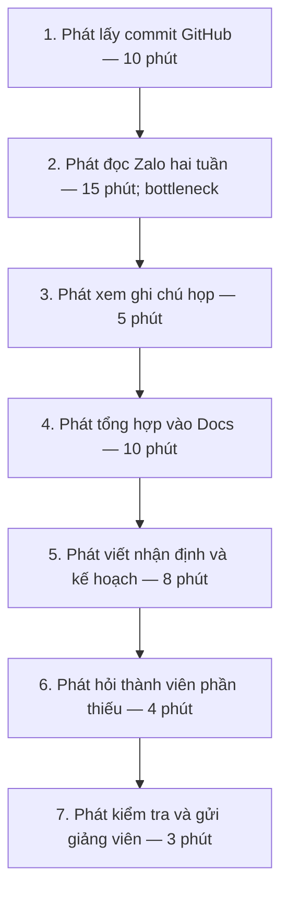
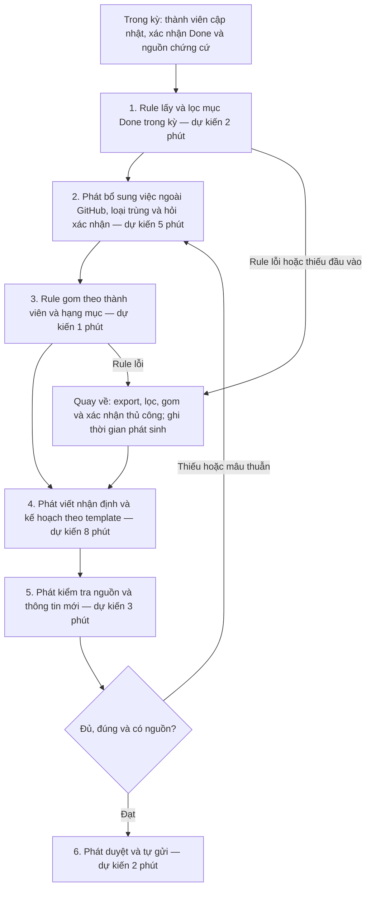

# Báo cáo nhóm — Day 02 Discovery & Problem Framing

> Bản chung của nhóm, viết trên repo do nhóm trưởng fork. Không copy file này sang repo cá nhân.
> Template chi tiết và prompt mẫu: [docs/01-worksheet.md](../../docs/01-worksheet.md). Bài mẫu: [docs/02-deliverable-example.md](../../docs/02-deliverable-example.md).

## 1. Thông tin nhóm

- Tên nhóm: Nhom4AE
- Thành viên: xem `TEAM.md`
- Candidate problem được chọn (1 câu): Khi tới hạn gửi báo cáo tiến độ cho giảng viên, người phụ trách muốn gom việc cả nhóm đã làm trong hai tuần qua vào một chỗ để gửi đúng hạn mà không phải lục lại commit và tin nhắn.
- Quyết định cuối: Go — pilot phạm vi nhỏ với Rule

---

## 2. Hội tụ nhóm (CP3)

### 2.1. Pitch

| # | Người đưa ra | Candidate (Job Story ngắn) | Actor | Bottleneck | Câu hỏi phản biện nhận được (ai hỏi) |
|---:|---|---|---|---|---|
| 1 | Nguyễn Tuấn Dũng | Điều chỉnh CV theo JD | Sinh viên CNTT năm cuối đang ứng tuyển | Đối chiếu JD và viết lại CV, khoảng 15 phút | **Trần Hoàng Phát:** Trong lần ứng tuyển gần nhất, 15 phút viết lại CV có tạo thay đổi đo được về phản hồi, hay một CV gốc theo nhóm vị trí đã đủ? |
| 2 | Nguyễn Tuấn Dũng | Chuẩn bị phỏng vấn kỹ thuật | Sinh viên chuẩn bị phỏng vấn thực tập/fresher | Xác định phạm vi, tìm tài liệu và ôn tập; ít nhất 3 ngày | **Nguyễn Huy Giang:** “Ba ngày” là thời gian lịch hay số giờ thực học; bước nào thực sự chiếm nhiều giờ nhất? |
| 3 | Nguyễn Tuấn Dũng | Nhập lại thông tin vào biểu mẫu | Sinh viên năm cuối làm thủ tục và ứng tuyển | Tìm và nhập lại thông tin ở nhiều định dạng, khoảng 30 phút | **Lê Sông Thao:** Lần gần nhất bạn điền form nào, bao nhiêu trường bị lặp và từng có lỗi không nhất quán gây hậu quả gì? |
| 4 | Trần Hoàng Phát | Gom việc hai tuần để viết báo cáo tiến độ | Người phụ trách báo cáo của nhóm bốn người | Đọc lại Zalo để tìm việc đã làm, khoảng 15 phút; toàn quy trình trung bình 55 phút | **Nguyễn Tuấn Dũng:** Nếu cả nhóm cập nhật một bảng chung ngay khi xong việc, thời gian 55 phút có giảm đủ để không cần AI không? |
| 5 | Trần Hoàng Phát | Tìm yêu cầu cuối cùng của giảng viên | Thành viên nhóm đồ án | Xác định yêu cầu còn hiệu lực; từng mất một ngày sửa do làm sai | **Nguyễn Huy Giang:** Vì sao nhóm chưa thống nhất một nguồn chính thức; nếu làm được thì pain còn lại là gì? |
| 6 | Trần Hoàng Phát | Thành viên không chạy được repository | Thành viên nhóm phát triển phần mềm | Tìm khác biệt môi trường, khoảng 45 phút | **Lê Sông Thao:** Sau khi có lockfile, hướng dẫn và môi trường container thống nhất, sự cố còn xảy ra bao nhiêu lần? |
| 7 | Nguyễn Huy Giang | Trích xuất action item sau họp | Nhóm trưởng và thành viên nhóm sinh viên | Tua file ghi âm để tìm nội dung giao việc, khoảng 20 phút | **Trần Hoàng Phát:** Nếu có thư ký ghi trực tiếp và dành năm phút cuối xác nhận task, 45 phút nghe lại có còn phát sinh không? |
| 8 | Nguyễn Huy Giang | Tra cứu công thức trong nhiều PDF | Sinh viên tự ôn thi cuối kỳ | Đọc và đối chiếu ngữ cảnh trong nhiều PDF, khoảng 20–30 phút/dạng bài | **Nguyễn Tuấn Dũng:** Người học cần tìm đúng đoạn tài liệu hay cần câu trả lời tổng hợp; kiểu sai nào gây hại hơn khi ôn thi? |
| 9 | Nguyễn Huy Giang | Kiểm tra tên file và bài nộp thiếu | Nhóm trưởng/lớp trưởng phụ trách thu bài | Đối chiếu từng tên file với danh sách, khoảng 20–25 phút | **Lê Sông Thao:** Vì tên file có cú pháp cố định, RegEx hoặc validation lúc nộp giải quyết được bao nhiêu phần trăm trường hợp? |
| 10 | Lê Sông Thao | Tổng hợp kết quả thực nghiệm và viết nhận định | Sinh viên thực hiện thực nghiệm ML/CV/NLP | Viết nhận định và phân tích lỗi, khoảng 25 phút; toàn quy trình khoảng 80 phút | **Nguyễn Huy Giang:** Nếu script đã xuất metrics và mẫu sai, phần nhận định còn mất bao lâu và có nhất thiết cần AI không? |
| 11 | Lê Sông Thao | Đối chiếu ảnh và lỗi OCR | Người phát triển pipeline nhận diện biển số | Mở biến thể ảnh và đối chiếu OCR thủ công, khoảng 30 phút | **Trần Hoàng Phát:** Visual error sheet và thống kê cặp ký tự nhầm có đủ giảm thời gian từ 55 xuống 15 phút không? |
| 12 | Lê Sông Thao | Đối chiếu log khi debug ESP32 | Sinh viên/kỹ sư nhúng và IoT | Đọc log và dò GPIO giữa code với sơ đồ, khoảng 7 phút/vòng | **Nguyễn Tuấn Dũng:** Nếu chuẩn hóa log và dùng checklist, vấn đề nào còn lại buộc phải dùng mức cao hơn Rule? |

### 2.2. Cluster

| Cluster | Các candidate | Pattern chung |
|---|---|---|
| A — Tìm việc và thủ tục cá nhân | 1. Điều chỉnh CV; 2. Chuẩn bị phỏng vấn; 3. Nhập biểu mẫu | Phải đọc, đối chiếu và nhập lại thông tin cá nhân theo từng ngữ cảnh mới. |
| B — Điều phối và truy xuất thông tin nhóm | 4. Báo cáo tiến độ; 5. Yêu cầu cuối của giảng viên; 7. Action item sau họp | Thông tin công việc và quyết định nằm rải rác, khiến nhóm phải tìm lại, xác nhận và tổng hợp thủ công. |
| C — Kiểm tra và tổng hợp đầu ra kỹ thuật/học tập | 6. Môi trường repository; 8. Tra cứu PDF; 9. Kiểm tra bài nộp; 10. Báo cáo thực nghiệm; 11. Lỗi OCR; 12. Debug ESP32 | Phải đối chiếu nhiều nguồn hoặc nhiều đầu ra kỹ thuật để tìm sai lệch và tạo kết quả đúng. |

### 2.3. Opportunity Solution Tree rút gọn

```text
OUTCOME: Giảm thời gian và số lần bỏ sót khi sinh viên tổng hợp thông tin
         cho các công việc lặp lại trong học tập, đồ án và tìm việc
├── Opportunity A: Thông tin cá nhân và yêu cầu tuyển dụng thay đổi theo từng ngữ cảnh
├── Opportunity B: Công việc, quyết định và yêu cầu của nhóm nằm rải rác ở nhiều kênh
└── Opportunity C: Kết quả kỹ thuật nằm ở nhiều file/đầu ra và phải đối chiếu thủ công
```

Những ý đã gạch bỏ vì là solution đội lốt opportunity:

- Chatbot tổng hợp báo cáo.
- Agent tự đọc GitHub và Zalo.
- Dashboard theo dõi tiến độ.
- RAG tra cứu tài liệu.
- Script tự động kiểm tra tên file.

### 2.4. Chấm điểm shortlist (1–5)

Shortlist ba candidate được nhóm chấm điểm:

1. Gom việc hai tuần để viết báo cáo tiến độ.
2. Trích xuất action item sau họp nhóm.
3. Tổng hợp kết quả thực nghiệm và viết nhận định phân tích lỗi.

| Candidate | Actor rõ | Quy trình rõ | Pain có bằng chứng | Impact đo được | Vừa sức lab | So sánh được No AI/Rule/Workflow/Agent | Nhóm hiểu domain | Tổng |
|---|---:|---:|---:|---:|---:|---:|---:|---:|
| Báo cáo tiến độ hai tuần | 5 | 5 | 5 | 5 | 5 | 5 | 5 | 35 |
| Action item sau họp | 5 | 5 | 4 | 5 | 4 | 5 | 5 | 33 |
| Báo cáo kết quả thực nghiệm | 4 | 5 | 4 | 5 | 4 | 5 | 4 | 31 |

**Candidate được chọn:**

Khi tới hạn gửi báo cáo tiến độ cho giảng viên, người phụ trách muốn gom việc cả nhóm đã làm trong hai tuần qua vào một chỗ để gửi đúng hạn mà không phải lục lại commit và tin nhắn.

**Vì sao chọn:**

- Actor và chu kỳ sử dụng rõ: một người phụ trách báo cáo cho nhóm bốn người, lặp lại mỗi hai tuần.
- Có baseline từ ba lần bấm giờ: 38, 71 và 55 phút, trung bình khoảng 55 phút.
- Bottleneck cụ thể: phải đọc lại Zalo và đối chiếu commit, ghi chú họp để xác định ai đã làm gì.
- Cả nhóm hiểu domain và có thể kiểm chứng với những nhóm sinh viên khác ngay trong lớp.
- Có thể so sánh công bằng giữa bảng chung/checklist, Rule lấy dữ liệu có cấu trúc và Workflow hỗ trợ soạn nháp.
- Có pilot nhỏ, metric thời gian và tiêu chí không bỏ sót công việc tương đối dễ đo.

**Vì sao loại các candidate còn lại:**

Action item sau họp: pain có thật và lặp lại, nhưng giải pháp No AI là chỉ định thư ký ghi trực tiếp cùng năm phút xác nhận cuối buổi có thể loại bỏ phần lớn 45 phút nghe lại. Chất lượng file ghi âm, quyền riêng tư và phát biểu chưa được chốt cũng làm tăng rủi ro nếu tự động trích task.

Báo cáo kết quả thực nghiệm: quy trình và baseline rõ, nhưng pain hiện có bằng chứng tập trung ở một thành viên và một số bài toán ML/CV cụ thể. Nhóm khó tìm mẫu kiểm chứng rộng bằng candidate báo cáo tiến độ; script xuất metrics cùng template nhận định cũng có thể giải phần lớn bottleneck trước khi cần AI.

**Xử lý bất đồng (nếu có):**

Nhóm không dùng tổng điểm như quyết định tự động. Nhóm đối chiếu bằng chứng và thống nhất chọn candidate có actor dễ tiếp cận, baseline rõ và khả năng kiểm chứng trong thời gian lab.

---

## 3. Kiểm chứng + research giải pháp đã có (CP4)

Nhóm chọn khảo sát nhanh với sinh viên các nhóm khác để kiểm tra mức độ phổ biến của vấn đề và đối chiếu với số liệu thời gian từ ba kỳ báo cáo của nhóm. Phần nghiên cứu giải pháp hiện có được dùng để xác định những bước đã có công cụ hỗ trợ và khoảng trống còn lại.

### 3.1. Assumption Map

| # | Giả định | Loại (Value / Usability / Feasibility / Viability) | Quan trọng (1–5) | Đã có bằng chứng (1–5) | Kiểm chứng trước? |
|---:|---|---|---:|---:|---|
| 1 | Người phụ trách báo cáo của các nhóm sinh viên khác cũng mất ít nhất 30 phút cho mỗi kỳ tổng hợp tiến độ. | Value | 5 | 1 | Có |
| 2 | Việc phải tìm dữ liệu rải rác giữa GitHub, tin nhắn và ghi chú họp là nguyên nhân chính gây chậm hoặc bỏ sót công việc. | Value | 5 | 3 | Có |
| 3 | Thành viên sẵn sàng cập nhật ngắn gọn công việc đã hoàn thành vào một nơi chung trong suốt hai tuần. | Usability | 5 | 1 | Có |
| 4 | Commit, issue và pull request chứa đủ dữ liệu để làm bằng chứng tiến độ, nhưng vẫn cần con người bổ sung phần việc không thể hiện trên GitHub. | Feasibility | 4 | 2 | Có |
| 5 | Nhóm có thể dùng một biểu mẫu/bảng chung mà không cần quyền truy cập tự động vào lịch sử Zalo hoặc dữ liệu riêng tư. | Feasibility | 5 | 2 | Có |
| 6 | Giảng viên chấp nhận báo cáo được tạo từ dữ liệu có cấu trúc hoặc bản nháp hỗ trợ, miễn người phụ trách kiểm tra trước khi gửi. | Viability | 4 | 1 | Có |

Giả định nhóm ưu tiên kiểm chứng: (1) việc tổng hợp báo cáo có đủ tốn thời gian để đáng giải quyết; (2) dữ liệu phân tán có phải nguyên nhân chính; và (3) việc ghi nhận tiến độ có cấu trúc có thể giảm nhu cầu tìm lại thông tin hay không.

### 3.2. Kiểm chứng bằng khảo sát nhanh

**Đối tượng:** 5–10 sinh viên thuộc các nhóm khác, ưu tiên người từng trực tiếp viết hoặc gom báo cáo tiến độ trong ba tháng gần nhất. Không thu họ tên, email hoặc thông tin nhận dạng.

**Kênh thực hiện:** khảo sát trực tiếp tại lớp hoặc Google Forms. Bộ câu hỏi đầy đủ đặt tại [`report/assets/cp4-micro-survey.md`](../assets/cp4-micro-survey.md).

**Trạng thái:** nhóm đã điền bảng tổng hợp 8 phản hồi, 7 hợp lệ bên dưới; bộ câu hỏi và quy tắc phân tích có trong assets. Repo chưa kèm bản phản hồi gốc đã ẩn danh hoặc thời điểm khảo sát, nên các số liệu được dẫn theo bảng tổng hợp của nhóm, chưa đối chiếu từng dòng phản hồi.

| # | Câu hỏi | Dạng trả lời | Mục đích |
|---:|---|---|---|
| 1 | Trong ba tháng gần nhất, bạn đã trực tiếp viết hoặc gom báo cáo tiến độ cho nhóm bao nhiêu lần? | 0 / 1–2 / 3–5 / trên 5 lần | Lọc người có trải nghiệm thật và đo tần suất |
| 2 | Ở lần gần nhất, bạn mất bao lâu để hoàn thành báo cáo? | dưới 15 / 15–30 / 31–60 / trên 60 phút | Đo baseline ngoài nhóm |
| 3 | Bạn phải mở những nguồn nào để biết nhóm đã làm gì? | Chọn nhiều: GitHub, chat, ghi chú họp, task board, tài liệu khác | Kiểm tra dữ liệu có phân tán hay không |
| 4 | Bước nào mất thời gian nhất ở lần gần nhất? | Tìm dữ liệu / hỏi thành viên / kiểm tra độ chính xác / viết nhận định-kế hoạch / định dạng | Xác định bottleneck |
| 5 | Trong ba kỳ báo cáo gần nhất, đã có lần nào thiếu việc hoặc phải hỏi lại thành viên không? | Không / 1 lần / 2 lần / 3 lần | Đo impact bằng hành vi đã xảy ra |
| 6 | Nhóm bạn hiện lưu tiến độ theo cách nào? | Câu trả lời ngắn | Tìm workaround và giải pháp đang dùng |
| 7 | Điều gì khiến cách hiện tại chưa giải quyết được hoàn toàn vấn đề? | Câu trả lời ngắn | Thu tín hiệu phản bác và khoảng trống |

**Quy tắc phân tích:** chỉ tính câu 2–7 của người chọn từ một lần trở lên ở câu 1. Vấn đề được xem là có tín hiệu xác nhận khi ít nhất một nửa số người hợp lệ mất trên 30 phút hoặc từng thiếu việc/phải hỏi lại. Tín hiệu phản bác được ghi nhận khi người trả lời hoàn thành dưới 15 phút, chỉ dùng một nguồn hoặc cho biết bảng quản lý công việc hiện tại đã đủ.

#### Baseline nội bộ để đối chiếu

| Kỳ báo cáo | Thời gian | Nguồn phải kiểm tra |
|---:|---:|---|
| 1 | 38 phút | GitHub, Zalo, ghi chú họp, Google Docs |
| 2 | 71 phút | GitHub, Zalo, ghi chú họp, Google Docs |
| 3 | 55 phút | GitHub, Zalo, ghi chú họp, Google Docs |

Baseline nội bộ trung bình khoảng **55 phút/kỳ**, lặp lại mỗi hai tuần.

#### Bảng tổng hợp khảo sát

| Chỉ số | Kết quả sau khi kết thúc khảo sát |
|---|---|
| Tổng số phản hồi | 8 |
| Số phản hồi hợp lệ | 7 |
| Tỷ lệ mất trên 30 phút | 57,1% (4/7) |
| Ba nguồn được mở nhiều nhất | Chat 100%; GitHub 85,7%; tài liệu chung 71,4% |
| Bước tốn thời gian nhất | Tìm dữ liệu từ nhiều nguồn, 42,9% (3/7) |
| Tỷ lệ từng thiếu việc hoặc phải hỏi lại | 71,4% (5/7) |
| Cách xử lý phổ biến | Xem lại chat và tự tổng hợp vào Google Docs |
| Tín hiệu phản bác | 2/7 người dùng task board đều cho biết quy trình hiện tại đã đủ dùng; 1/7 người hoàn thành dưới 15 phút |

| Nguồn | Số người / số mẫu | Tín hiệu xác nhận | Tín hiệu phản bác |
|---|---:|---|---|
| Khảo sát nhanh sinh viên nhóm khác | 8 phản hồi, trong đó 7 hợp lệ | 4/7 người mất trên 30 phút; 5/7 người từng thiếu việc hoặc phải hỏi lại; các nguồn được mở nhiều nhất là chat, GitHub và tài liệu chung | 2/7 người dùng task board đều cho biết cách hiện tại đã đủ; 1/7 người hoàn thành dưới 15 phút |
| Time log nội bộ | 3 kỳ báo cáo của 1 người phụ trách | Cả ba kỳ đều phải kiểm tra GitHub, Zalo, ghi chú họp và Google Docs; thời gian dao động 38–71 phút, trung bình khoảng 55 phút | Tần suất chỉ hai tuần/lần; kỳ nhanh nhất mất 38 phút nên giải pháp phức tạp có thể không tương xứng |
| Câu trả lời mở về cách xử lý hiện tại | 7 phản hồi hợp lệ | 3/7 người vẫn xem lại chat và tự tổng hợp; 3/7 cho biết thành viên không cập nhật đều; 3/7 gặp vấn đề vì thông tin nằm ở nhiều kênh | 2/7 người đã dùng task board hoặc bảng chung và đánh giá quy trình hiện tại tương đối hiệu quả |

**Nhóm đã điều chỉnh bài toán thế nào theo kết quả được tổng hợp:**

| Điểm điều chỉnh | Căn cứ trong bảng tổng hợp | Hệ quả đối với bài làm |
|---|---|---|
| Thu hẹp đối tượng | 4/7 người mất trên 30 phút, nhưng 2/7 người đã thấy task board đủ dùng | Tập trung vào người tổng hợp của nhóm có thông tin phân tán và còn phải hỏi lại; không khẳng định mọi nhóm sinh viên đều cần giải pháp mới. |
| Sửa cách thu dữ liệu trước khi tăng mức can thiệp | 3/7 cho biết thành viên không cập nhật đều; 3/7 gặp thông tin ở nhiều kênh | Yêu cầu cập nhật có cấu trúc và xác nhận trạng thái; Rule lọc/gom, không tự đọc Zalo hoặc suy tiến độ từ commit. |
| Đo cả chất lượng và phần việc chuyển sang thành viên | 5/7 từng thiếu việc hoặc phải hỏi lại; bảng chung đã đủ với một số người | Giữ kiểm tra nguồn, không bỏ sót và đo cập nhật của cả nhóm. Target dưới 25 phút và giới hạn 10 phút/người/kỳ là mục tiêu thiết kế do nhóm chọn, chưa phải kết quả khảo sát chứng minh đạt. |

Những điều chỉnh trên dựa trên số liệu do nhóm đã tổng hợp; cần phản hồi gốc đã ẩn danh và thời điểm thu thập để xác minh từng kết luận. Không tạo lại các phiếu riêng lẻ từ tỷ lệ tổng hợp.

### 3.3. Research giải pháp đã có

Các liên kết chính thức trong bảng đã được mở kiểm tra ngày 09/11/2026. Research dùng để đối chiếu khả năng công cụ và pattern quy trình; không được xem là kết quả pilot hay bằng chứng các nhóm khảo sát đã dùng các công cụ này.

| Công cụ / case / pattern | Link | Giải bước nào trong quy trình? | Điểm mạnh | Khoảng trống / rủi ro | Bài học cho nhóm |
|---|---|---|---|---|---|
| GitHub Issues + Projects | [GitHub Docs — About issues](https://docs.github.com/en/issues/tracking-your-work-with-issues/learning-about-issues/about-issues), [Planning and tracking with Projects](https://docs.github.com/en/issues/planning-and-tracking-with-projects) | Ghi và theo dõi task, issue, pull request; cung cấp bảng/board/roadmap, custom field và filter để xem tiến độ | Tích hợp trực tiếp với repository; dữ liệu công việc có cấu trúc và truy vết được | Không tự biết nội dung thảo luận trên Zalo, họp hoặc phần việc không tạo issue/PR; commit không đồng nghĩa với outcome | Chuẩn hóa nơi ghi task trước sẽ giải phần lớn bước “lục lại”; không nên bắt AI suy diễn toàn bộ tiến độ chỉ từ commit |
| Microsoft Teams Updates | [Microsoft Support — Get started in Updates](https://support.microsoft.com/en-us/teams/updates-app/get-started-in-updates), [Managing the Updates app](https://support.microsoft.com/en-us/teams/updates-app/managing-the-updates-app) | Yêu cầu cập nhật định kỳ theo template, đặt người nộp/người xem và deadline; theo dõi tình trạng nộp, xem lịch sử và export | Giải đúng pattern thu cập nhật có cấu trúc; có recurrence, trường bắt buộc và export | Yêu cầu nhóm dùng Teams/Microsoft 365; không tự gom lịch sử Zalo; thêm một nơi cần duy trì | Pattern quan trọng là “push request + template + nhắc thiếu”, không nhất thiết phải tự xây công cụ hoặc dùng AI |
| Geekbot asynchronous standups | [Geekbot — Async Standup Meetings](https://geekbot.com/standups/) | Hỏi thành viên theo lịch trong Slack/Teams, tổng hợp câu trả lời thành report và nhắc người chưa phản hồi | Giảm việc người phụ trách phải hỏi từng người; có lịch sử báo cáo và reminder | Trang chính thức mô tả Slack/Teams, chưa có căn cứ hỗ trợ Zalo; vẫn phụ thuộc thành viên trả lời đều đặn và cần xem chi phí/dữ liệu | Giá trị chính đến từ thói quen cập nhật định kỳ; AI soạn narrative chỉ nên là bước sau khi dữ liệu đầu vào đã đủ |

---

## 4. Quy trình trước/sau (CP5)

**Phụ trách:** Lê Sông Thao, Phát hỗ trợ. Có dùng Codex hỗ trợ Mermaid và rà soát. [Tài liệu CP5 và nguồn](../assets/cp5-lesongthao-workflow-draft.md).

**Nguồn và phạm vi:** thời gian hiện tại theo card Phát; 38/71/55 phút là 3 kỳ tự báo cáo, trung bình 54,67 phút, làm tròn khoảng 55. Chưa có log gốc từng bước. Theo quyết định CP6 tại nhánh chung, phương án chính là **Rule**, khoảng 21 phút và target dưới 25; phương án No AI khoảng 36 phút của card gốc là đối chiếu, chưa phải kết quả đã đo.

### 4.1. Quy trình hiện tại — khoảng 55 phút



| Bước | Actor | Input | Output | Thời gian hiện tại theo card |
|---:|---|---|---|---:|
| 1 | Phát | Commit trong kỳ, danh sách thành viên | Danh sách thay đổi và đường dẫn | 10 phút |
| 2 | Phát | Tin nhắn Zalo trong hai tuần | Ghi chú ai làm gì, việc thiếu/blocker | 15 phút |
| 3 | Phát | Ghi chú họp | Quyết định và kế hoạch đã thống nhất | 5 phút |
| 4 | Phát | Thông tin bước 1–3 | Bản tổng hợp trong Docs | 10 phút |
| 5 | Phát | Bản tổng hợp, kết quả và blocker | Nhận định, kế hoạch kỳ tới | 8 phút |
| 6 | Phát và thành viên liên quan | Nội dung thiếu hoặc chưa rõ | Thông tin được bổ sung/xác nhận | 4 phút |
| 7 | Phát | Bản báo cáo hoàn thiện | Báo cáo được kiểm tra và gửi giảng viên | 3 phút |

**Bottleneck:** bước 2, phải tìm công việc trong tin nhắn lẫn nhiều nội dung khác. Commit là nguồn chứng cứ thay đổi mã, không tự xác nhận công việc đã hoàn thành hoặc bao phủ phần việc ngoài code.

### 4.2. Quy trình tương lai — Rule, khoảng 21 phút

**Đầu vào trong kỳ:** bốn thành viên cập nhật task có người phụ trách, hạng mục, kết quả, trạng thái được xác nhận, ngày hoàn thành và liên kết bằng chứng. Nhóm trưởng đề xuất khoảng 1–2 phút/task và giới hạn 10 phút/người/kỳ; đây là giả thuyết cần đo. Thời gian cập nhật này nằm ngoài 21 phút lập báo cáo và vẫn phải tính vào công sức cả nhóm.



| Bước khi lập báo cáo | Loại | Actor | Input → output | Thời gian kỳ vọng | Kiểm tra / boundary |
|---:|---|---|---|---:|---|
| 1 | Rule | Bộ lọc theo quy tắc | Task board, issue/PR và kỳ báo cáo → danh sách mục hợp lệ | 2 phút | Chỉ đọc nguồn được phép; lấy theo ngày hoàn thành trong kỳ; không suy Done từ commit hoặc việc PR đã merge. |
| 2 | Con người | Phát và thành viên liên quan | Danh sách, ghi chú họp và xác nhận → việc ngoài GitHub, mục đã loại trùng và thông tin còn thiếu | 5 phút | Dùng mã task để tránh một việc bị đếm nhiều lần theo các PR; thiếu hoặc mâu thuẫn thì hỏi người phụ trách. |
| 3 | Rule | Bộ gom dữ liệu | Danh sách đã đối chiếu → bảng theo owner/hạng mục | 1 phút | Chỉ sắp xếp/định dạng, không tự thay đổi trạng thái, deadline hoặc mức ưu tiên. |
| 4 | Con người | Phát | Bảng và nguồn → nhận định/kế hoạch theo template | 8 phút | Giữ quyền diễn giải ở con người; không tạo cam kết chưa xác nhận. |
| 5 | Con người | Phát | Bản báo cáo và nguồn → bản đã kiểm tra | 3 phút | Kiểm tra đủ thành viên, đúng kỳ, trạng thái, nguồn và blocker; mọi bổ sung mới phải qua bước này trước khi gửi. |
| 6 | Con người | Phát | Bản đạt kiểm tra → báo cáo được gửi giảng viên | 2 phút | Chỉ Phát duyệt và gửi; Rule không có quyền gửi. |

**Tổng:** `2 + 5 + 1 + 8 + 3 + 2 = 21 phút`, gồm **6 bước ở thời điểm lập báo cáo: 2 Rule + 4 con người**. Cộng thêm hoạt động cập nhật task trong kỳ thành 7 hoạt động của thiết kế mới. Tất cả số phút tương lai là ước tính; thời gian hỏi, sửa, chờ hoặc quay về phát sinh phải ghi đủ, không giữ cứng 21 phút.

**Phương án quay về:** Rule lỗi, thiếu trường hoặc không lấy được dữ liệu thì người phụ trách export task board, lọc/gom thủ công, bổ sung việc ngoài GitHub và đối chiếu nguồn. Sau đó vẫn tự viết nhận định, kiểm tra và gửi; không bỏ qua kiểm tra để giữ target. Bản gốc chỉ được đọc, không bị sửa/xóa.

**Boundary chung:** không đọc lịch sử chat riêng tư; không suy hoàn thành từ số commit, Closed hay Merged; không tự đổi owner/deadline, bịa task hoặc gửi báo cáo. Trạng thái và ngày hoàn thành phải do người phụ trách việc xác nhận. Dữ liệu chưa xác nhận được ghi rõ và được xử lý trước khi gửi.

### 4.3. Before / after và kế hoạch đo

| Chỉ số | Hiện tại | Rule, kỳ vọng | Phạm vi / giới hạn |
|---|---|---|---|
| Bước tại thời điểm lập báo cáo | 7 | 6 | Có thêm hoạt động cập nhật task trong kỳ; không tính nó thành thao tác lập báo cáo. |
| Thao tác thủ công tại thời điểm lập báo cáo | 7 | 4 | Hai bước còn lại là lọc và gom bằng Rule. |
| Thời gian người tổng hợp | Khoảng 55 phút; mẫu 38/71/55 | Khoảng 21 phút; target dưới 25 phút/kỳ | Chưa có pilot; tính cả kiểm tra, sửa và quay về. |
| Tổng thời gian Rule | Không có | Khoảng 3 phút: lọc 2 + gom 1 | Tiêu chí CP6 cần nhất quán với cả hai bước, không nhầm tổng Rule thành dưới 2 phút. |
| Bottleneck | Đọc Zalo khoảng 15 phút | Viết nhận định khoảng 8 phút | Judgment do Phát giữ. |
| Cập nhật của mỗi thành viên trong kỳ | Chưa có baseline | Mục tiêu không quá 10 phút/người/kỳ | Ghi cho cả 4 người, gồm Phát; không đếm trùng phần tổng hợp. |
| Chất lượng | Baseline câu giảng viên hỏi lại còn thiếu | Không bỏ sót mục hợp lệ, đúng owner/kỳ và 100% có nguồn | Báo số mục thiếu/sai, không chỉ đếm câu hỏi của giảng viên. |
| Rủi ro mới | Thông tin phân tán | Task thiếu trường, sai trạng thái hoặc Rule lọc sai | Bắt buộc xác nhận, đối chiếu, và có export/template thủ công. |

Đo từng bước mỗi kỳ; ghi thời gian sửa/quay về, thời gian cập nhật task của cả 4 người, mục bị bỏ sót/sai và nguồn đối chiếu. Dùng cùng quy ước tính thời gian với baseline; ghi riêng thời gian chờ nếu có. Dữ liệu chất lượng chưa có ghi “chưa có dữ liệu”, không thay bằng 0.

Pilot theo quyết định nhóm: thử 2 kỳ, nếu đạt tiếp tục tới đủ 4 kỳ liên tiếp. Với chu kỳ hai tuần, tương ứng khoảng 4 và 8 tuần; đây là kế hoạch, chưa chạy xong trong lab. Ngưỡng dừng và tiêu chí chính thức xem mục 7–8 báo cáo nhóm.

---

## 5. Problem Statement v0 (CP5)

| Trường | Nội dung |
|---|---|
| **Actor** | Người phụ trách tổng hợp và gửi báo cáo tiến độ định kỳ cho giảng viên của một nhóm bốn sinh viên. |
| **Quy trình** | Mỗi hai tuần, actor phải thu thập phần việc từ GitHub, lịch sử chat và ghi chú họp; đối chiếu thông tin; hỏi thành viên về mục còn thiếu; viết nhận định, kế hoạch rồi kiểm tra và gửi báo cáo. |
| **Bottleneck** | Dữ liệu tiến độ nằm rải rác và không có cấu trúc, khiến actor mất khoảng 15 phút đọc lại Zalo và phải tiếp tục đối chiếu các nguồn khác trước khi viết báo cáo. |
| **Impact** | Toàn quy trình mất trung bình khoảng 55 phút mỗi kỳ, dao động 38–71 phút; báo cáo có nguy cơ thiếu phần việc, dùng sai trạng thái hoặc phát sinh trao đổi hỏi lại sát hạn. |
| **Success Metric** (baseline → target, cách đo) | Giảm thời gian của người phụ trách từ trung bình 55 phút xuống dưới 25 phút/kỳ trong bốn kỳ liên tiếp; không có mục công việc đã được xác nhận trên task board nhưng bị bỏ sót; 100% nhận định và kế hoạch có nguồn đối chiếu. Đo bằng time log, checklist nguồn và số mục phải sửa/hỏi lại sau khi tạo bản nháp. Ghi riêng tổng thời gian các thành viên cập nhật task để tránh chuyển chi phí sang người khác. |
| **Boundary** (AI không được làm gì; khi nào cần con người kiểm tra — HITL) | AI không được tự đọc kênh chat riêng tư, tự suy diễn công việc từ commit, bịa task/số liệu/deadline, thay đổi dữ liệu gốc hoặc tự gửi báo cáo. Người phụ trách phải đối chiếu mọi nội dung với task board, GitHub hoặc xác nhận của thành viên và duyệt bản cuối trước khi gửi. |

Phản biện nhận được (từ AI hoặc nhóm khác) và nhóm có đồng ý không:

- **Baseline mới có ba lần đo và dao động 38–71 phút:** đồng ý. Nhóm dùng baseline 55 phút như điểm bắt đầu và tiếp tục bấm giờ trong bốn kỳ pilot thay vì coi đây là giá trị cố định.
- **Target dưới 25 phút có thể chỉ chuyển thời gian sang cho ba thành viên cập nhật task:** đồng ý. Nhóm đo riêng thời gian lập báo cáo và tổng thời gian cập nhật task của cả nhóm.
- **Problem Statement có thể lẫn giải pháp nếu mô tả task board, Rule hoặc AI trong phần problem:** đồng ý. Sáu trường v0 chỉ mô tả actor, quy trình, bottleneck, impact, metric và boundary; chi tiết giải pháp nằm ở quy trình tương lai.
- **Tự động đọc Zalo tạo rủi ro riêng tư và khó xác định thông tin nào đã được chốt:** đồng ý. Quy trình tương lai không tự động đọc Zalo; dữ liệu đầu vào phải đến từ task board, GitHub hoặc xác nhận trực tiếp.
- **AI có thể viết trôi chảy nhưng bỏ sót hoặc thêm nhận định không có nguồn:** đồng ý. Mọi nhận định phải có nguồn đối chiếu và người phụ trách bắt buộc duyệt trước khi gửi.

---

## 6. Mức can thiệp AI (CP6)

### 6.1. Ma trận độ mơ hồ × độ phức tạp

Bài của nhóm nằm ở ô: **độ mơ hồ cao × độ phức tạp cao** đối với quy trình hiện tại; sau khi chuẩn hóa dữ liệu đầu vào, phần thu thập và định dạng chuyển về độ mơ hồ thấp và có thể xử lý bằng Rule.

Vì sao: báo cáo phải tổng hợp từ ít nhất ba nguồn, có hơn ba bước phụ thuộc nhau và phần nhận định có nhiều cách viết chấp nhận được. Tuy nhiên, việc lọc task theo kỳ, nhóm theo thành viên/hạng mục và điền template đều có quy tắc rõ. Nhóm không cần một Agent tự quyết bước tiếp theo; phần cần judgment vẫn do người phụ trách thực hiện.

### 6.2. So sánh 4 mức

| Mức | Phương án cho bài của nhóm | Đủ khi nào | Rủi ro | Chọn? |
|---|---|---|---|---|
| **No AI** (sửa quy trình) | Dùng task board/bảng chung, quy ước mỗi thành viên cập nhật task và người phụ trách điền template thủ công | Đủ nếu thời gian lập báo cáo ổn định dưới 25 phút và không bỏ sót việc | Thành viên quên cập nhật; người phụ trách vẫn phải lọc, copy và nhóm dữ liệu thủ công | Không chọn làm mức cuối; dùng làm phương án quay về |
| **Rule** | Lọc issue/PR/task Done theo khoảng ngày, nhóm theo thành viên và hạng mục, xuất dữ liệu vào template; con người viết nhận định, kiểm tra và gửi | Đủ khi dữ liệu có cấu trúc và phần khó nhất còn lại là judgment của người phụ trách | Rule lấy thiếu mục ngoài GitHub hoặc phân loại sai nếu trường dữ liệu không đầy đủ | **Chọn** |
| **Workflow** | Rule thu thập dữ liệu → AI soạn narrative → con người kiểm tra → con người gửi | Chỉ cần nếu pilot Rule vẫn trên 25 phút chủ yếu do bước viết narrative | AI có thể thêm nhận định không có nguồn; thời gian kiểm tra có thể triệt tiêu lợi ích | Chưa chọn; chỉ thử khi Rule không đạt target |
| **Agent** | Tự chọn nguồn, tự hỏi thành viên, tự lặp và tự hoàn thiện báo cáo | Chỉ phù hợp nếu quy trình thay đổi liên tục và không thể định trước các bước | Quyền truy cập rộng, rủi ro riêng tư, khó kiểm soát và không tương xứng với báo cáo hai tuần/lần | Không chọn |

**Mức chọn:** Rule.

**Vì sao không chọn mức đơn giản hơn:** No AI giải quyết gốc vấn đề bằng kỷ luật cập nhật và là baseline bắt buộc, nhưng người phụ trách vẫn phải lọc, sao chép và nhóm dữ liệu của bốn thành viên mỗi kỳ. Rule phù hợp với phần có đúng/sai rõ, giúp giảm thao tác cơ học mà không giao phần judgment cho AI. Nhóm không chọn Workflow hoặc Agent vì chưa có bằng chứng Rule không đạt mục tiêu dưới 25 phút.

### 6.3. AI Canvas rút gọn

| Thành phần | Nội dung |
|---|---|
| **Prediction** — AI dự đoán / tạo ra gì? | Không áp dụng. Giải pháp được chọn không dùng AI để dự đoán hoặc tạo nội dung. |
| **Judgment** — con người cân nhắc, quyết định gì? | Người phụ trách quyết định công việc nào đáng nêu, cách diễn giải kết quả, blocker và kế hoạch kỳ tiếp theo. |
| **Action** — hành động cuối cùng là gì, ai làm? | Rule xuất dữ liệu theo template; người phụ trách viết, kiểm tra và tự gửi báo cáo. |
| **Outcome** — đo kết quả bằng gì? | Thời gian lập báo cáo dưới 25 phút, không bỏ sót task đã xác nhận và mọi nội dung có liên kết nguồn. |
| **Input** — AI cần dữ liệu đầu vào gì mỗi lần chạy? Có sẵn không? | Không có input cho AI. Rule đọc issue, pull request và task board có trường người phụ trách, trạng thái, hạng mục, kết quả và liên kết bằng chứng. |
| **Feedback** — lấy phản hồi ở đâu để cải thiện? | Time log, mục bị thiếu/sai, lỗi Rule, câu hỏi của giảng viên và phản hồi của thành viên được ghi sau mỗi kỳ pilot. |

### 6.4. Hai câu hỏi của Google PAIR

- Người dùng muốn **được hỗ trợ (augment)** hay **giao hẳn việc (automate)**? Không áp dụng cho giải pháp Rule. Người phụ trách chỉ tự động hóa thao tác lọc và định dạng; quyền diễn giải, kiểm tra và gửi vẫn thuộc con người.
- AI sai kiểu nào tệ hơn, **báo nhầm** hay **bỏ sót**? Không áp dụng vì không dùng AI. Với Rule, cả lấy nhầm task và bỏ sót task đều được kiểm soát bằng khoảng ngày, trạng thái Done, trường bắt buộc, liên kết nguồn và checklist trước khi gửi.

---

## 7. Problem Statement v1 + tiêu chí đánh giá (CP6)

| Trường | Nội dung |
|---|---|
| **Actor** | Người phụ trách tổng hợp và gửi báo cáo tiến độ định kỳ cho giảng viên của một nhóm bốn sinh viên. |
| **Quy trình** | Trong kỳ, thành viên cập nhật task có cấu trúc. Mỗi hai tuần, Rule lọc và nhóm task/issue/PR đã hoàn thành; người phụ trách bổ sung việc ngoài GitHub, viết nhận định theo template, đối chiếu nguồn và tự gửi. |
| **Bottleneck** | Dữ liệu tiến độ chưa được cập nhật đầy đủ và có cấu trúc; nếu đầu vào đạt yêu cầu, bottleneck còn lại là khoảng 8 phút judgment của người phụ trách để viết nhận định và kế hoạch. |
| **Impact** | Quy trình hiện tại mất trung bình 55 phút, dao động 38–71 phút; có nguy cơ thiếu việc, dùng sai trạng thái hoặc phải hỏi lại thành viên sát hạn. |
| **Success Metric** (baseline → target, cách đo) | Từ trung bình 55 phút xuống dưới 25 phút/kỳ trong bốn kỳ liên tiếp; 0 task Done có bằng chứng bị bỏ sót; 100% mục trong báo cáo có liên kết nguồn; tổng thời gian cập nhật task của mỗi thành viên không quá 10 phút/kỳ. Đo bằng time log, checklist và log lỗi Rule. |
| **Boundary** | Rule chỉ đọc repository/task board được cho phép, không đọc Zalo, không suy diễn mức độ hoàn thành, không sửa dữ liệu gốc và không gửi báo cáo. Người phụ trách kiểm tra tất cả mục và chịu trách nhiệm bản cuối. |
| **AI intervention point** | Không có. Rule xử lý phần xác định được bằng logic; narrative và quyết định vẫn do con người viết. |
| **Mức chọn** | Rule |
| **Rủi ro & người kiểm tra** | Rủi ro chính là dữ liệu đầu vào thiếu, task gắn sai người hoặc Rule lọc sai khoảng ngày. Người phụ trách kiểm tra bằng checklist; thành viên xác nhận mục của mình trước khi gửi. |

**Thay đổi so với v0 và lý do:**

| Trường | v0 | v1 | Vì sao đổi |
|---|---|---|---|
| Quy trình | Thu thập thủ công từ GitHub, chat và ghi chú họp | Thành viên cập nhật task; Rule lọc/nhóm dữ liệu; con người viết và gửi | CP6 chọn Rule sau khi so sánh bốn mức |
| Bottleneck | Đọc lại Zalo và đối chiếu nhiều nguồn | Chất lượng dữ liệu có cấu trúc; sau đó là judgment viết narrative | Research cho thấy cần sửa cách ghi nhận dữ liệu trước |
| Success Metric | Dưới 25 phút, không bỏ sót, có nguồn | Giữ target và thêm giới hạn 10 phút cập nhật/người/kỳ | Tránh chuyển chi phí từ người phụ trách sang thành viên |
| Boundary | Giới hạn AI và bắt buộc con người duyệt | Không có AI; Rule chỉ đọc/định dạng, không sửa hoặc gửi | Mức Rule loại bỏ rủi ro tạo nội dung của AI |
| AI intervention point | Chưa chốt | Không có | Chưa có bằng chứng cần Workflow AI |

**Tiêu chí đánh giá đầu ra của giải pháp Rule (5 tiêu chí):**

| # | Tiêu chí | Đạt khi | Không đạt khi |
|---:|---|---|---|
| 1 | Đầy đủ | 100% task đủ điều kiện trong kỳ sau loại trùng theo task_id xuất hiện trong tổng hợp; trạng thái Done được xác nhận và có nguồn issue/PR/task board | Bỏ sót ít nhất một mục hợp lệ hoặc đếm một việc thành nhiều việc theo số PR |
| 2 | Chính xác | Người phụ trách, trạng thái, hạng mục và khoảng ngày khớp nguồn | Có trường sai, trùng hoặc lấy nhầm ngoài kỳ |
| 3 | Truy vết được | Mỗi mục có liên kết tới task, issue hoặc pull request gốc | Có mục không thể đối chiếu nguồn |
| 4 | Hiệu quả thời gian | Toàn bộ quy trình người phụ trách dưới 25 phút; hai pha Rule tổng không quá 3 phút (lọc 2 + gom 1) | Tổng từ 25 phút hoặc Rule quá 3 phút là chưa đạt; riêng tổng thời gian từ 25 phút ở hai kỳ liên tiếp thì dừng theo mục 8 |
| 5 | An toàn dữ liệu | Chỉ đọc nguồn được cho phép, không sửa dữ liệu và không gửi tự động | Truy cập chat riêng tư, thay đổi dữ liệu gốc hoặc tự gửi báo cáo |

**Ca đánh giá cụ thể:** [10 cặp input/đầu ra mong đợi cho Rule](../assets/cp6-rule-evaluation-cases.md), gồm dữ liệu đúng, chưa xác nhận, sai kỳ, trùng, thiếu/mâu thuẫn trường, ngoài quyền và lỗi nguồn. Đây là ví dụ tổng hợp chưa chạy trên triển khai, không phải kết quả pilot hoặc bộ eval AI để nhận bonus B3. Tiêu chí thời gian phải được đo riêng trên triển khai và trong các kỳ báo cáo thật.

---

## 8. Quyết định (CP6)

### 8.1. Bốn rủi ro

| Rủi ro | Câu hỏi | Mức độ rủi ro (Thấp = an toàn / TB / Cao = nguy hiểm) | Lý do / bằng chứng |
|---|---|---|---|
| **Value** | Người dùng có thật sự cần và sẽ dùng không? | Trung bình | Baseline nội bộ là 55 phút/kỳ và khảo sát cho thấy có pain, nhưng mẫu còn nhỏ; task board thủ công có thể đã đủ với một số nhóm |
| **Usability** | Người dùng có dùng được, có hiểu và sửa được đầu ra không? | Trung bình | Template và Rule dễ kiểm tra, nhưng giá trị phụ thuộc cả bốn thành viên cập nhật task đầy đủ và đúng trường |
| **Feasibility** | Có đủ dữ liệu, công cụ, kỹ năng để làm không? | Thấp | GitHub issue/PR và task board có dữ liệu có cấu trúc; lọc theo trạng thái, ngày và người phụ trách là logic xác định được |
| **Viability** | Có hợp chi phí, pháp lý, quy định tổ chức không? Ai vận hành? | Thấp | Không dùng AI, không đọc chat riêng tư, chi phí công cụ thấp; người phụ trách báo cáo quản lý template và Rule |

### 8.2. Kết luận

**Quyết định:** Go — pilot phạm vi nhỏ với Rule.

**Lý do:** Không có rủi ro nào ở mức Cao. Rule giải phần cơ học có đúng/sai rõ, giữ judgment và hành động gửi cho con người, đồng thời có phương án quay về template thủ công. Pilot cho phép kiểm tra target trước khi cân nhắc Workflow AI.

**Nếu Go — pilot nhỏ nhất:** Trong hai kỳ báo cáo tiếp theo, cả nhóm cập nhật task có các trường người phụ trách, trạng thái, hạng mục, kết quả và liên kết bằng chứng. Rule lọc các mục Done trong kỳ và điền template; người phụ trách tự viết nhận định, kiểm tra, gửi và ghi time log. Nếu pilot đạt, tiếp tục đo đến đủ bốn kỳ liên tiếp để xác nhận success metric.

**Nếu Not Yet — cần kiểm chứng gì trước:** Không áp dụng cho quyết định hiện tại.

**Nếu No-Go — nên làm gì thay AI:** Không áp dụng; giải pháp được chọn đã không dùng AI.

**Ngưỡng dừng:** Đánh giá sau hai kỳ: nếu thời gian người phụ trách từ 25 phút/kỳ trở lên ở cả hai kỳ, Rule bỏ sót từ một task hợp lệ trở lên, hoặc có thành viên tốn trên 10 phút/kỳ để duy trì dữ liệu, nhóm dừng Rule và quay về task board + template thủ công; sau đó xác định lại bottleneck trước khi thử mức khác.

---

## 9. Hạn chế và hướng tiếp theo

- Baseline thời gian mới có ba kỳ và khảo sát có quy mô nhỏ, nên kết luận chỉ áp dụng cho pilot nhóm sinh viên.
- Rule phụ thuộc vào việc thành viên cập nhật task đúng hạn và đủ trường; cần kiểm tra tỷ lệ tuân thủ sau mỗi kỳ.
- Công việc ngoài GitHub vẫn cần con người bổ sung và xác nhận.
- Chỉ xem xét Workflow có AI nếu Rule không đạt target và time log chứng minh bottleneck còn nằm ở bước viết narrative.

## 10. Tài liệu tham khảo

- [GitHub Docs — About issues](https://docs.github.com/en/issues/tracking-your-work-with-issues/learning-about-issues/about-issues)
- [GitHub Docs — Planning and tracking with Projects](https://docs.github.com/en/issues/planning-and-tracking-with-projects)
- [Microsoft Support — Get started in Updates](https://support.microsoft.com/en-us/teams/updates-app/get-started-in-updates)
- [Microsoft Support — Managing the Updates app](https://support.microsoft.com/en-us/teams/updates-app/managing-the-updates-app)
- [Geekbot — Async Standup Meetings](https://geekbot.com/standups/)
